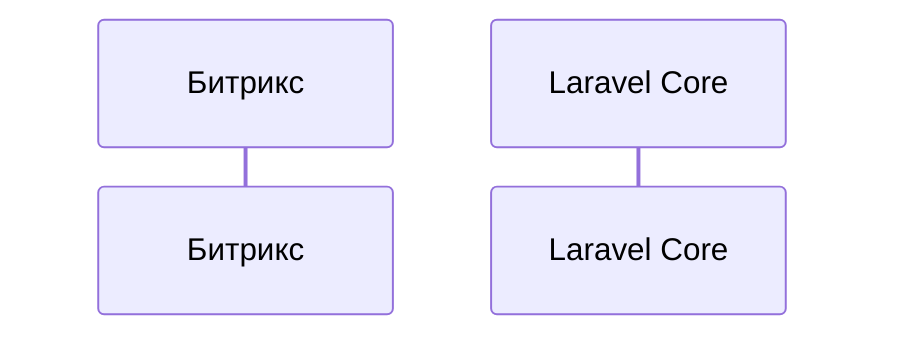

# <Вид интеграции> (`<код>`)

> Этап roadmap: N. Демо: `make demo-<код>`.

## Когда так делают

Типичные коммерческие ситуации, плюсы и минусы относительно других видов.

## Сценарий «ПрофСпорта»

Что передаётся, кто инициатор, как часто, объёмы.

## В Laravel это было бы…

Аналогия с привычными инструментами Laravel (Jobs, Events, HTTP Client, Scout, Passport…) и что в Битриксе устроено иначе.

## Реализация

- Битрикс: порт, адаптер, обработчики, агенты/CLI (пути к файлам).
- Laravel Core: контроллеры, джобы, команды (пути к файлам).
- Контракт: `contracts/...`.

## Надёжность

Таймауты, ретраи и backoff, идемпотентность, порядок сообщений, что видно в журнале интеграций.

## Подводные камни

Что ломается в реальных проектах и как это обнаружить.

## Как проверить

Шаги демо и ожидаемый результат; какие тесты это покрывают.
