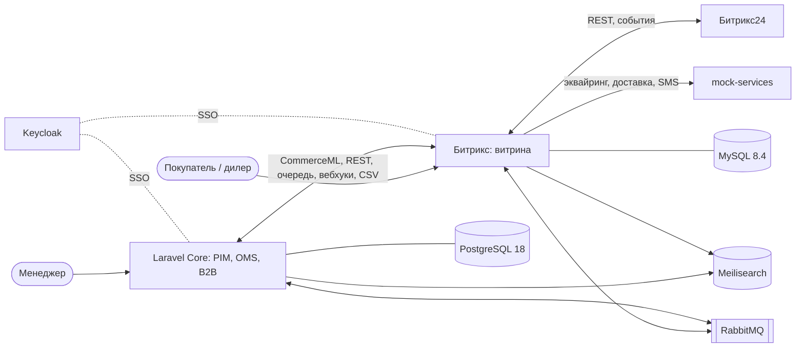

# Roadmap v2 — «ПрофСпорт»: Laravel Core + витрина на Битриксе

> Источник истины по этапам с 2026-11-08 (ADR 0003). Исходное ТЗ — [bitrix-integration-lab-SPEC.md](../bitrix-integration-lab-SPEC.md): его раздел 0 (правила) и критерии приёмки по сторонним сервисам действуют, где здесь не сказано иное.

## Легенда

**«ПрофСпорт»** — дистрибьютор спортивной экипировки. Продаёт в розницу (B2C) и дилерам — клубам, школам, магазинам (B2B, договорные цены и отсрочка). Склады в Москве, Екатеринбурге и Новосибирске. Товары с SKU по размеру и цвету.

У компании уже есть **собственный бэкенд на Laravel** («ПрофСпорт Core»), и к нему подключают интернет-магазин на 1С-Битрикс. Это типичная коммерческая задача: «у заказчика своя учётная система / OMS, нужен сайт на Битриксе и все интеграции».

## Кто за что отвечает

| Система | Роль | Мастер-данные |
|---|---|---|
| **Laravel Core** (`apps/laravel-core`) | PIM, цены и прайс-листы, остатки и склады, OMS (жизненный цикл заказа), клиенты и договоры B2B, админка менеджеров (Filament), B2B-кабинет, отчёты | товары, цены, остатки, заказы, клиенты |
| **Битрикс** (`www/`, `local/`) | витрина: каталог, SEO, контент, корзина, оформление, ЛК B2C; интеграции со сторонними сервисами витрины | представление каталога, корзина, черновик заказа до передачи в OMS |
| **Битрикс24** (облако) | CRM отдела продаж; интеграция — со стороны сайта (как в вакансиях Битрикс-разработчика) | сделки, коммуникации |
| **mock-services** | только **сторонние** сервисы: эквайринг (а-ля ЮKassa), доставка (а-ля СДЭК), SMS-шлюз, маркетплейс | — |

## Виды интеграции

Каждый вид показывается отдельно и оформляется `docs/integrations/<код>.md` по [шаблону](integrations/_template.md): когда так делают в коммерции, sequence-диаграмма, «в Laravel это было бы…», подводные камни, как запустить демо (`make demo-<код>`).

| Код | Вид | Сценарий «ПрофСпорта» |
|---|---|---|
| `commerceml` | Файловый обмен CommerceML | Laravel в роли «1С»: каталог, цены, остатки → штатный `1c_exchange.php`; забирает заказы, возвращает статусы |
| `queue` | Очередь + Transactional Outbox | заказ с витрины → OMS; события OMS (статусы) → витрина. DLQ, ретраи, graceful shutdown |
| `webhooks` | Подписанные вебхуки | Laravel мгновенно сообщает о смене цены и статуса заказа: HMAC, timestamp, идемпотентность |
| `rest-pull` | REST pull | Битрикс забирает дельту остатков из Laravel API: OAuth2 client credentials, курсорная пагинация, `updated_since` |
| `sync-call` | Синхронный вызов с фолбэком | на оформлении — договорная цена B2B и резерв в Laravel; при недоступности — базовая цена и флаг менеджеру |
| `bitrix-api` | Битрикс как REST-провайдер | B2B-кабинет в Laravel показывает историю заказов с витрины: D7-контроллеры, API-ключ/JWT, rate limit, OpenAPI |
| `batch-csv` | Пакетная сверка файлами | ночью полная сверка остатков: CSV по SFTP |
| `search` | Общий поисковый индекс | Laravel Scout индексирует в Meilisearch, компонент поиска Битрикса читает индекс |
| `anti-patterns` | Прямое чтение БД и prolog в artisan | разбор «почему так можно, но не нужно» (варианты Б/В этапа 15 ТЗ) |
| `sso` | SSO (OIDC) | дилер входит один раз — и в магазин, и в B2B-кабинет (Keycloak) |

Канал передачи заказов в OMS — один порт `OrderExporter` в модуле и два адаптера (`commerceml`, `queue`); активный выбирается в DI (`.settings.php` → `services`). Так одна и та же бизнес-операция показывает два вида интеграции без дублирования логики.

## Этапы

Порядок: строго по номерам. Этап закрыт, когда код + тесты + проверена приёмка + обновлены `docs/progress.md` и доки интеграции.

| № | Этап | Основа в ТЗ | Приёмка |
|---|---|---|---|
| 1 | Инфраструктура | 1 | `make up` поднимает всё; сайт открывается; кеш Битрикса в Redis; `make test` с бутстрапом |
| 2 | Каркас модуля `lab.integration`: журнал, outbox, HTTP-клиент, админ-страница журнала | 2 | модуль ставится/удаляется; любой исходящий запрос виден в журнале |
| 3 | **Laravel Core**: домен (товары/SKU, склады, прайс-листы, клиенты и договоры, заказы со state machine), Filament, сиды (~1000 товаров, 3 склада, B2B-клиенты), Passport, Core API v1 + OpenAPI, контейнеры `core` + `postgres`, Pest/Larastan/Pint в CI | — | `make up` поднимает Core; вход в Filament; сиды разворачиваются с нуля; тесты и анализ зелёные |
| 4 | Каталог Битрикса: инфоблоки, SKU, HL «Бренды» — миграциями; минимальный фронт | 3 | миграции с нуля разворачивают каталог; заказ оформляется |
| 5 | `commerceml`: Laravel → Битрикс (полный протокол `type=catalog` и `type=sale`) | 4 | 1000 товаров с SKU, ценами, остатками; повторная загрузка обновляет по XML_ID (= UUID в Core); заказ попадает в OMS; статус «оплачен» из OMS применяется |
| 6 | `queue`: outbox → RabbitMQ ↔ Laravel (нейтральный JSON-контракт, не формат Laravel Jobs); агенты на cron | 9 | Core выключен — заказы копятся и доходят после включения; битое сообщение уходит в DLQ |
| 7 | `webhooks`: Laravel → Битрикс | — | неверная подпись → 401; повтор (replay) отклонён; дубль не применяется дважды |
| 8 | `rest-pull`: остатки из Core API, таблица соответствий ID | 10 | 10 000 позиций за разумное время, без запросов в цикле; остатки совпадают |
| 9 | `sync-call`: B2B-цена и резерв на оформлении | 8 (фолбэк) | Core недоступен — заказ оформляется по базовой цене с флагом; таймаут соблюдается |
| 10 | `bitrix-api`: REST API сайта + страница в B2B-кабинете Laravel | 5, 15А | спецификация валидна; e2e создаёт заказ; без ключа 401; лимит 429; кабинет показывает заказы |
| 11 | Эквайринг и доставка (mock-services) | 7, 8 | как в ТЗ; после оплаты событие уходит в OMS |
| 12 | `batch-csv`: ночная сверка по SFTP | 10 | после сверки остатки совпадают с Core |
| 13 | `search`: Scout → Meilisearch → компонент Битрикса | 11 | изменение товара в Filament видно в поиске витрины за секунды; фолбэк на штатный поиск |
| 14 | Битрикс24 со стороны сайта; робот «Проверить остаток» спрашивает Core | 6 | как в ТЗ |
| 15 | Фиды и маркетплейс | 12 | как в ТЗ; заказ маркетплейса доходит до OMS |
| 16 | Уведомления: почта и SMS (Битрикс), Telegram о заказе (Laravel Notifications из OMS) | 13 | как в ТЗ |
| 17 | `anti-patterns`: read-only подключение Laravel к БД Битрикса, artisan с prolog | 15Б, 15В | сравнение задокументировано, демо работает |
| 18 | Наблюдаемость обеих систем | 16 | healthcheck; дашборд ошибок и очередей; алерт |
| 19 | Тестирование и CI для обеих систем, контрактные тесты Битрикс ↔ Core | 17 | CI зелёный; контракты проверяются с обеих сторон |
| 20 | `sso`: Keycloak для витрины и B2B-кабинета (опционально) | 14 | дилер входит один раз в обе системы и получает группы/роли |

## Правила для Laravel Core (дополняют раздел 0 ТЗ)

- Laravel 13, PHP 8.4, PostgreSQL 18; код в `apps/laravel-core`, свой контейнер.
- Слои по аналогии с модулем: домен не зависит от Eloquent там, где это оправдано; контроллеры тонкие; интеграционные контракты — DTO (spatie/laravel-data) с версией.
- Pest, Larastan (уровень ≥ 6), Pint — в CI.
- Межсистемные контракты (JSON-схемы сообщений, OpenAPI обеих сторон) — в `contracts/`, проверяются тестами с обеих сторон.
- Секреты — `.env` Laravel (в `.gitignore`) + `.env.example`.
